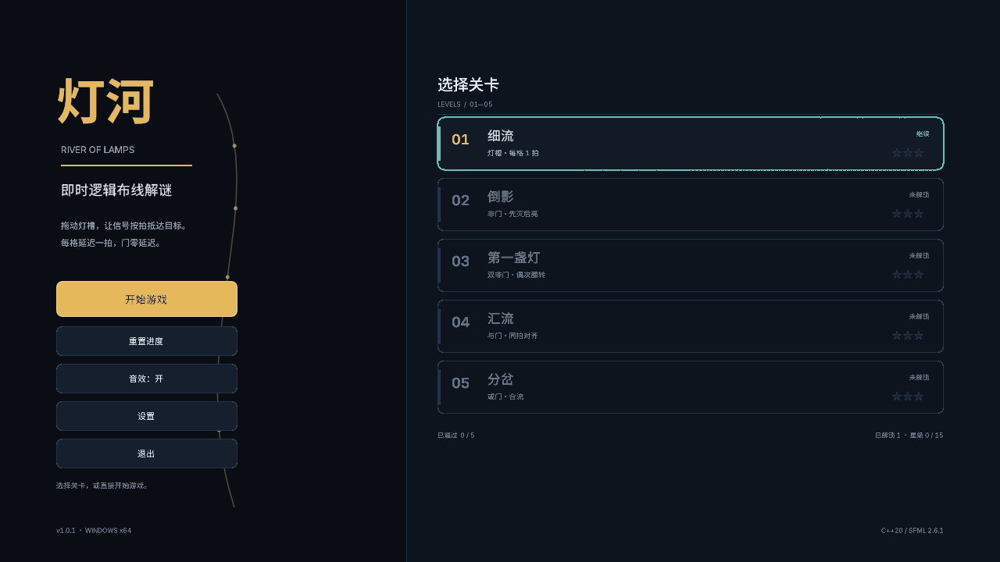
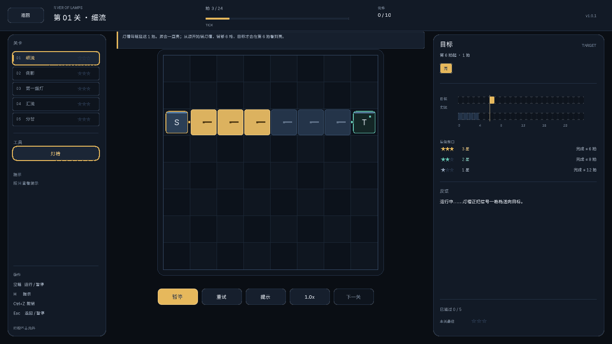
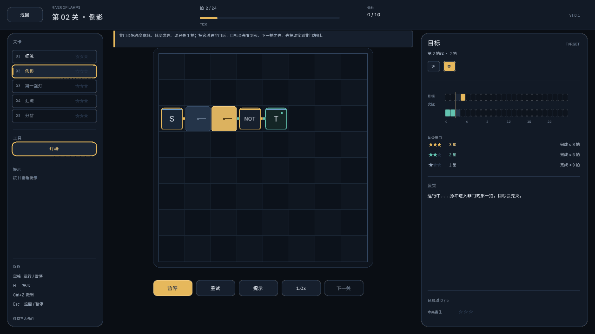
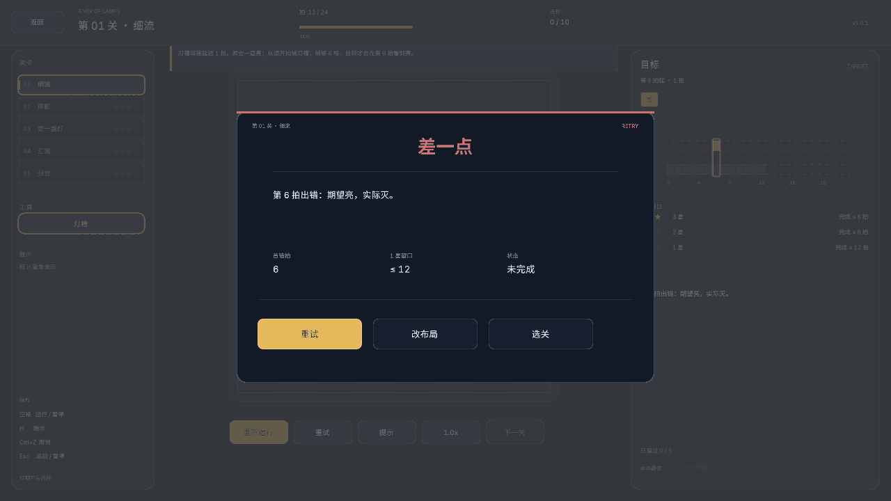
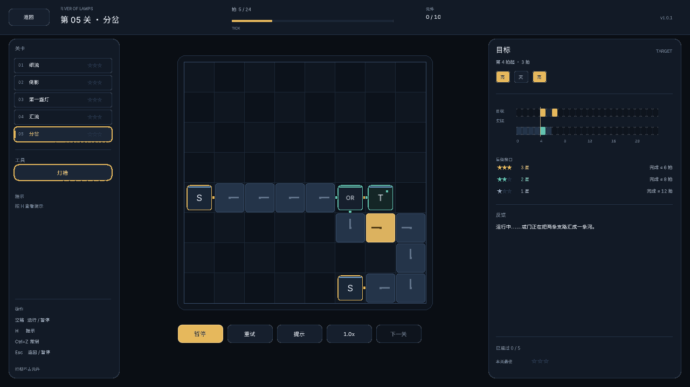
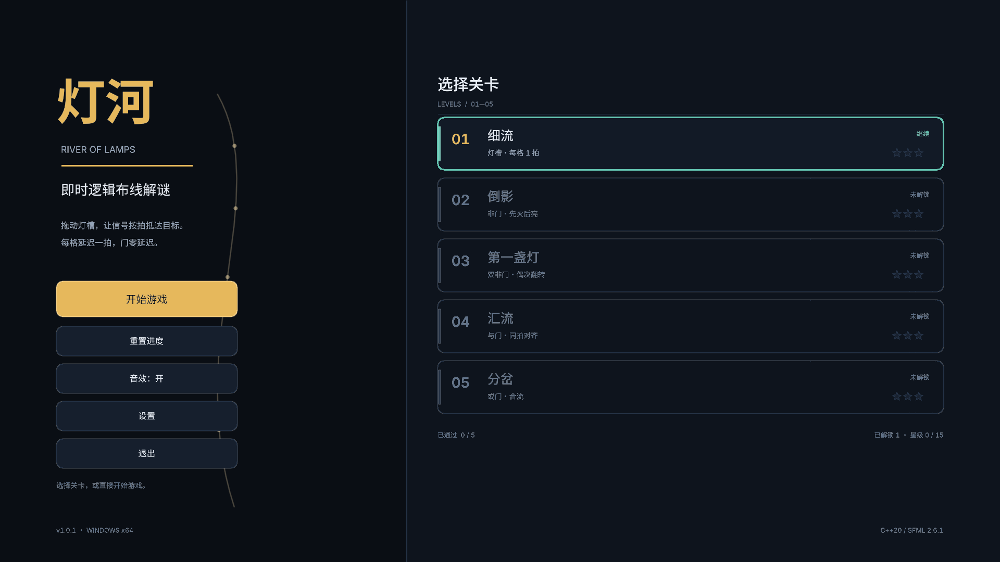
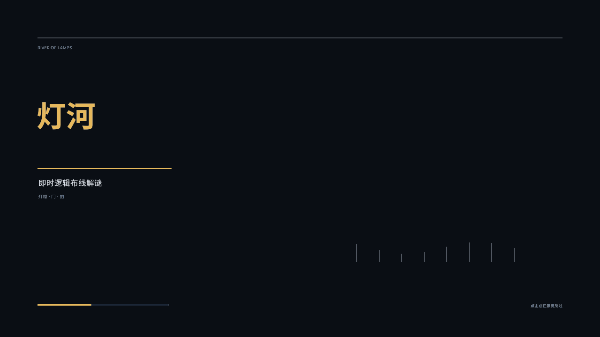
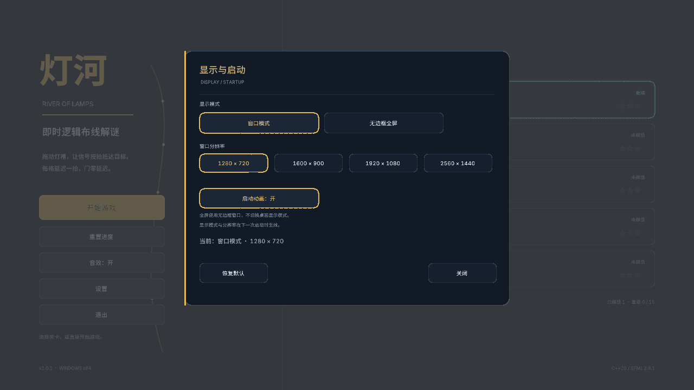
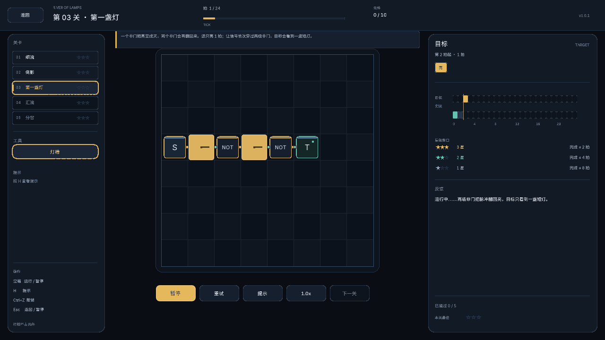

# 灯河 / River of Lamps

一个“在网格上布灯槽，让信号按拍到达目标”的即时逻辑布线解谜游戏。

> **当前版本：v1.0.1（2026-10-28）**  
> Windows x64 免安装包：  
> **[下载 river-of-lamps-v1.0.1-win64.zip](https://github.com/liuyandi386/river-of-lamps/releases/download/v1.0.1/river-of-lamps-v1.0.1-win64.zip)**
>
> 解压后双击 `RiverOfLamps.exe`；不需要 Godot、SFML 或任何运行库。  
> 更新日志：[update.md](update.md) · 源码：[liuyandi386/river-of-lamps](https://github.com/liuyandi386/river-of-lamps)

当前版本是**独立 C++20 + SFML 2.6.1 + Dear ImGui 1.89.9（ImGui-SFML 2.6.1）** 程序：
界面由 ImGui 的 draw list、字体图集和统一主题渲染，棋盘/灯槽仍由 SFML 直接绘制。不需要 Godot；旧的 GDScript 工程已于 2026-10-27 移除。

---

## 下载与运行（免安装）

1. 下载 `river-of-lamps-v1.0.1-win64.zip`；
2. **把整个文件夹一起解压**到任意目录（不要只把 exe 单独拖出来）；
3. 双击 `RiverOfLamps.exe` 开始游戏；
4. 存档自动保存在 `%APPDATA%\RiverOfLamps\progress.json`；显示设置保存在同目录的 `settings.json`。

发布包内包含：

| 文件/目录 | 说明 |
|---|---|
| `RiverOfLamps.exe` | 主程序，约 6.1 MiB，静态链接 |
| `README.md` | 本说明 |
| `update.md` | 更新日志 |
| `THIRD_PARTY_NOTICES.md` | 第三方组件说明 |
| `data/levels/` | 关卡 JSON（外部可修改；exe 内也有嵌入兜底） |
| `cpp/screenshots/` | 游戏截图 |
| `docs/`、`licenses/` | 迁移/规则文档与许可证 |

> 如果从源码跑，见下面的“源码构建”。免安装包不需要编译器。

## 源码构建

前置：Windows x64、MinGW-w64 GCC 11.5（或更新）、CMake ≥ 3.20。  
依赖已放在 `cpp/third_party/`（SFML 2.6.1、Dear ImGui 1.89.9、ImGui-SFML 2.6.1、nlohmann/json、Sarasa UI SC 子集），不需要 vcpkg、网络或 Godot。

### 一键

```text
build_cpp.bat
```

产出：

- `build\RiverOfLamps.exe` —— 双击即玩
- `build\river_tests.exe` —— 逻辑/星级测试

### 手动

```powershell
$env:PATH = "C:\Program Files\RedPanda-Cpp\mingw64\bin;$env:PATH"
cmake -S cpp -B build -G "MinGW Makefiles" -DCMAKE_BUILD_TYPE=Release
cmake --build build -j 8
.\build\RiverOfLamps.exe
```

详细依赖、迁移说明和 jyfactorio 工具链依据见 [`docs/migration_cpp.md`](docs/migration_cpp.md)。

### UI 技术栈

- **Dear ImGui 1.89.9**：负责界面层（draw list、字体图集、文本测量、抗锯齿图元）；
- **ImGui-SFML 2.6.1**：ImGui 的 SFML 2.6 后端；
- **Sarasa UI SC（更纱黑体 UI SC，SIL OFL 1.1）**：正文 Regular、标题 SemiBold、展示字 Bold 三个子集内嵌；拉丁来自 Inter，汉字来自思源黑体，按 UI 间距设计；
- 字体按目标物理像素加载：1280 下正文 20px、标题 34px、展示 76px；1920 下分别按 1.5 倍加载，再由 `DisplayFramebufferScale` 映射，避免放大发虚；
- 两者均以源码放在 `cpp/third_party/`，MIT，静态编译进 exe，无运行时 DLL；
- CMake 中是独立静态库 `river_imgui`，`build_cpp.bat` 无需额外步骤；
- 棋盘/灯槽仍由 SFML 绘制，界面与棋盘分层，不影响模拟时序。

## 显示与启动

主菜单的 **设置** 面板提供：

- **窗口模式**：1280×720、1600×900、1920×1080、2560×1440 四档；
- **全屏**：无边框窗口全屏，使用桌面尺寸 − 2px，覆盖桌面但不调用 `sf::Style::Fullscreen`；
- 不再提供独占全屏。原因是 SFML 2.6.1 的 Windows 全屏实现会调用
  `ChangeDisplaySettings(CDS_FULLSCREEN)`，在 Windows 10/11 + DWM 下会触发显示模式切换和闪黑屏；
  无边框窗口全屏不改变桌面显示模式，Alt-Tab 也更稳定；
- 无边框全屏窗口取 **桌面尺寸 − 2px**（例如 2560×1600 → 2558×1598）。窗口恰好等于桌面时，
  Windows 会把它当作“全屏应用”交给 DirectFlip/MPO 呈现路径；本机（Intel Arc + Win11）该路径会
  定格旧帧并周期性闪黑。少 2px 后保持 DWM 合成；
- 有焦点时临时 `HWND_TOPMOST`，失焦时恢复 `HWND_NOTOPMOST`；任务栏不会盖住游戏，Alt-Tab 也能退出；
- 进程启动时 `ImmDisableIME`，本作没有文本输入，避免输入法候选窗/语言栏与无边框置顶窗口抢 Z 序；
- **启动动画**：默认开启，每次启动播放 2.2 秒；点击鼠标或按任意键跳过；
- 设置立即写入 `%APPDATA%\RiverOfLamps\settings.json`，**显示模式/分辨率重启后生效**；面板会明确提示，不会在运行中重建窗口；
- 布局以 1280×720 为设计坐标，按实际窗口做 `FramebufferScale` 缩放；鼠标坐标反算回设计坐标，棋盘点选/拖拽精度不因放大而丢失；
- 16:9 的窗口预设为等比放大；无边框全屏在非 16:9 桌面上按桌面宽高铺满，鼠标命中同步按宽高反算，不会出现“画面放大但点击错位”。

开场动画只推进自己的 2.2 秒计时，不推进模拟、不改变输入初始化或棋盘状态；可在设置中关闭。

## 怎么玩

- 左栏选“灯槽”。
- 从**信号源**按住左键，沿网格拖到**目标端口**（或门的输入旁）。
- 灯槽每格延迟 **1 拍**；门是 0 延迟。
- 点 **运行**（或按空格）看灯一格一格亮。
- 失败时，右侧波形会标红第一处错误，反馈区写“第几拍、期望、实际”。
- 右键删除整条灯槽。
- 通过后按拍数拿 **1–3 星**，并解锁下一关。

### 按键

| 操作 | 按键 |
|---|---|
| 运行 / 暂停 | `Space` |
| 重试（保留布局） | `Backspace` |
| 提示 / 教学 | `H` |
| 撤销 | `Ctrl+Z` |
| 暂停 / 返回 | `Esc` |
| 静音 | `M` |
| 删除灯槽/元件 | 鼠标右键 |
| 放置/拖拽灯槽 | 鼠标左键 |

运行中不能编辑；先暂停，或直接改（修改会自动重置本次运行）。

## 星级

目标序列可以在 `start_tick` 之后整体后移，只要在 1 星窗口内结束就能通关：

- 完成拍 ≤ `star_thresholds.three`：3 星；
- 完成拍 ≤ `star_thresholds.two`：2 星；
- 完成拍 ≤ `star_thresholds.one`：1 星；
- 超过 `one`：失败。

3 星阈值贴着每关参考解，必须压拍数；2 星适度放宽；1 星只要通关。  
通关界面会显示星级和“再快几拍可上一档”，关卡选择界面显示历史最高星级。

## 当前 5 关

| 关 | 名字 | 教什么 | 参考完成拍 |
|---|---|---|---|
| 1 | 细流 | 灯槽连通 + 每格 1 拍；唯一最短直线 | 6 |
| 2 | 倒影 | 非门：源脉冲翻成先灭后亮，不能直连通关 | 3 |
| 3 | 第一盏灯 | 两级非门：翻转两次恢复亮，和单非门关卡不同 | 2 |
| 4 | 汇流 | 与门：两路同一拍到达 | 4 |
| 5 | 分岔 | 标准 OR：1+0/0+1/1+1 都亮；两路错开 2 拍才形成亮-灭-亮 | 6 |

关卡数据在 [`data/levels/`](data/levels/)，每关有 `hint`、`reference_solution`、`reference_finish` 和 `star_thresholds`。  
第 1、2 关额外有 `teach`，会显示在游戏顶部教学条。

## 截图





















> 改前的截图基线保存在 [`cpp/screenshots/before_ui/`](cpp/screenshots/before_ui/)，可与上面的改后截图对照。

## 运行测试

```powershell
.\build\river_tests.exe
# 或
ctest --test-dir build --output-on-failure
```

测试覆盖：

- 灯槽 1 格 = 1 拍；
- 非门 + 脉冲；
- 与门两路对齐；
- 或门“亮-灭-亮”，以及 OR 1/1 仍输出高（不是 XOR）；
- 首错拍；
- 零延迟门链不误报毛刺；
- 5 关参考解均拿到 **3 星**（完成拍 6/3/2/4/6）；
- 星级边界：刚好 3 星、刚好 2 星、窗口内 1 星、窗口内无匹配失败；
- 星级存档：最高星级保存/读档、重置删除存档；
- 显示设置存档：模式、窗口分辨率、启动动画开关的保存/读档；
- 旧版 `display_mode=1`（独占全屏）迁移为无边框全屏；
- 未连线时报错。

## 目录

```text
River of Lamps/
├─ build/                     构建产物（exe/tests）
├─ build_cpp.bat              一键配置 + 编译
├─ run_cpp.bat                启动游戏
├─ package_cpp.bat            打包免安装 zip
├─ data/
│  └─ levels/                 关卡 JSON + index.json + elements.json
├─ cpp/
│  ├─ src/app/                窗口、开始/关卡选择、设置、画布、波形、音效、存档
│  ├─ src/core/               网格、模拟器、关卡仓库、元件规则
│  ├─ src/generated/          嵌入的 JSON/字体（生成文件）
│  ├─ tests/main.cpp          逻辑 + 星级边界测试
│  ├─ third_party/            SFML 2.6.1 / Dear ImGui / ImGui-SFML / nlohmann / Sarasa UI SC 子集
│  └─ screenshots/            C++ 版截图
├─ docs/
│  ├─ design/outline.md       设计大纲
│  ├─ design/decisions.md     拍板记录（含星级、OR/NOT 澄清）
│  ├─ rules/element_rules.md  模拟规则
│  ├─ migration_cpp.md        C++ 迁移历史 + GDScript 移除记录
│  └─ screenshots/            旧版历史截图
├─ README.md
├─ update.md                  更新日志
├─ THIRD_PARTY_NOTICES.md     第三方组件说明
└─ 概要.txt
```

## 打包发布

生成 Windows x64 免安装 zip：

```text
package_cpp.bat
```

产出 `dist\river-of-lamps-v1.0.1-win64.zip`，包含 exe、README、update、第三方说明、关卡数据、文档与许可证。
打包前需要先执行 `build_cpp.bat`。

## 发布信息

- 当前版本：**v1.0.1**（2026-10-28）
- GitHub Release：<https://github.com/liuyandi386/river-of-lamps/releases/tag/v1.0.1>
- 更新日志：[update.md](update.md)
- 第三方组件与许可证：[THIRD_PARTY_NOTICES.md](THIRD_PARTY_NOTICES.md)

## 已知限制

- 门是预置的，玩家目前主要画灯槽；门还不能旋转。
- 灯槽不能分叉、交叉、覆盖已有灯槽。
- 只有单目标端口；没有多目标/多源。
- 没有第二批（延迟/脉冲/触发器/计数器/中继/衰减）和第三批（干扰/屏蔽）。
- 毛刺目前只检测“组合环不收敛”，还没有逐事件竞争检测。
- 没有关卡编辑器；关卡是手写 JSON。
- 没有背景音乐、手柄、完整本地化。
- 无边框全屏窗口比桌面小 2px，有焦点时才置顶；这是规避“恰好铺满触发 DirectFlip/MPO”
  和任务栏遮挡的刻意取舍。非 16:9 桌面上画面会有轻微纵向拉伸，鼠标命中已同步换算。
- 快速甩动鼠标仍可能跳过中间格（与改前一致）；缩放后棋盘格物理尺寸更大，没有额外劣化。

## 接下来做什么

1. 先试玩 5 关，确认第 1 关 5 分钟内通过、第 2 关能理解非门。
2. 手感 OK 后做**第二批**：延迟元件、脉冲发生器、边沿触发器、计数器，以及 C5 中继/确定性衰减。
3. 再做**第三批**：干扰、屏蔽、真正的竞争毛刺。
4. 内容稳定后再做关卡编辑器。

> 旧 GDScript 已移除；迁移过程、保留物和删除日期见 [`docs/migration_cpp.md`](docs/migration_cpp.md)。

## 许可证

游戏自身代码未单独附 LICENSE（默认保留所有权利）；第三方组件许可证见
[`THIRD_PARTY_NOTICES.md`](THIRD_PARTY_NOTICES.md) 与 `licenses/`。

